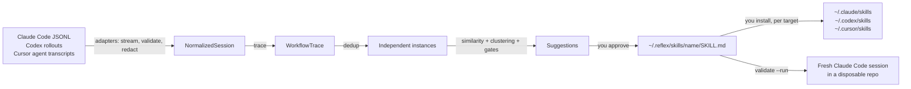

# Architecture

Reflex is a local CLI. It reads coding-agent history you point it at, and writes only inside its
own folder until you explicitly install a skill.

## Packages

| Package | Responsibility |
| --- | --- |
| `@reflex/core` | Session model (`NormalizedSession`, `SessionEvent`, `WorkflowTrace`), adapter interface, hashing, debug counters |
| `@reflex/safety` | Redaction, leak detection, path containment, slug validation, no-follow/exclusive file writes |
| `@reflex/adapters` | Claude Code, Codex and Cursor parsers: detection, permission prompt, bounded discovery, streaming parse |
| `@reflex/analysis` | Command classification, traces, de-duplication, similarity, clustering, consensus steps, suggestions |
| `@reflex/storage` | SQLite (`node:sqlite`) store in `REFLEX_HOME` (default `~/.reflex`) |
| `@reflex/embeddings` | Optional sentence embeddings: the model registry (bge-m3 default, all-MiniLM-L6-v2 light), pinned streaming download and verification, WordPiece and Hugging Face tokenizers, onnxruntime-web (WebAssembly) inference, per-model reference means, machine checks |
| `@reflex/skills` | SKILL.md generation, validation, diffs, install planning, fresh-task sandbox |
| `@reflex/test-fixtures` | Synthetic transcripts in the real on-disk layouts, for tests only (not bundled) |
| `@reflex/tui` | Full-screen terminal UI: the `TuiData` contract, layout ported from the design prototype, terminal I/O, and the live data source over the store |
| `apps/cli` | Commands and prompts (`commander`, `@clack/prompts`), bundled with tsup; the build copies the onnxruntime-web WebAssembly runtime (14 MB) next to the bundle |

Internal packages export TypeScript source; only the CLI is built.

## Adapters

Each adapter implements `detect` (location and file count, no reads), `requestPermission`,
`discover` (fixed depth, no symlinks, mtime window) and `parse` (stream line by line, Zod-validate,
skip bad lines, cap line size and events per session).

- Claude Code: `~/.claude/projects/<encoded-cwd>/<session>.jsonl`. `user`/`assistant` records with
  string or block content (`text`, `tool_use`, `tool_result`). Sidechain, meta, harness-injected and
  duplicate-uuid records are dropped.
- Codex: `$CODEX_HOME/sessions/YYYY/MM/DD/rollout-*.jsonl`. `{timestamp, type, payload}` lines:
  `session_meta`, `response_item` (messages, `shell`/`exec_command` calls, `local_shell_call`,
  `apply_patch`, outputs with exit codes), `event_msg`. The parser follows the Codex protocol types;
  it has been tested on fixtures, not on real rollouts (no Codex history on the development machine).
- Cursor: `~/.cursor/projects/<encoded-workspace>/agent-transcripts/<id>/<id>.jsonl`. `{role, message:
  {content: [text | tool_use]}}` lines plus `turn_ended` markers. The developer's request is the
  `<user_query>` block; session time comes from Cursor's `<timestamp>` tag. Tools map onto the same
  events (`Shell`, `Read`/`ReadFile`, `StrReplace`, `Write`, `ApplyPatch`, `Grep`/`rg`/`Glob`).
  Background-task notifications are skipped. Agents a chat launched (`Task` / `Subagent` tool calls:
  `subagent_type`, `model`, `run_in_background`, `description`) are recorded on the session, and
  their transcripts (`<id>/subagents/*.jsonl`, up to 300) are read for tool calls only: their
  user messages (the parent agent's prompt) and assistant text are dropped. Those events, marked
  `byAgent`, are inserted after the first launch, since Cursor records no times or tool results that
  would place each agent. A chat's file identity folds in its agent transcripts (summed size,
  latest mtime and ctime), so a background agent finishing later re-reads the chat. The workspace path is decoded
  by checking which folders exist (metadata only). Cursor records no tool results, so its sessions
  never count as "recovered from a failure". Tested on fixtures and parsed cleanly on real history.

- Conductor: not a separate source. Its bundled Claude Code and Codex write to `~/.claude` and
  `~/.codex`. `SessionBuilder.build` recognizes a working folder under
  `<...>/conductor/workspaces/<repo>/<workspace>` (each workspace is a git worktree): the project is
  `<repo>`, hashed from the `<repo>` folder so every workspace of it is one repository, and the
  session gets `harness: {name: "conductor", workspace}`.

All text is truncated and redacted inside the adapter, before anything else sees it.

Token usage, where recorded, is attached to the session as `{input, output, cacheRead, cacheWrite}`:

- Claude Code: `message.usage` on assistant records, counted once per `message.id` (Claude Code
  repeats the same usage on every content-block record of one API message). Sidechain records are
  skipped, so subagent tokens are not included.
- Codex: the last cumulative `event_msg` `token_count.info.total_token_usage`. `input_tokens`
  includes `cached_input_tokens`, so the cached part is moved into `cacheRead`. Like the rest of the
  Codex parser, this follows the protocol types and is tested on fixtures only.
- Cursor: no usage in its transcripts. Its app database (`state.vscdb`, table `cursorDiskKV`) has
  per-message `tokenCount` fields, but they are always 0. With a second consent, Reflex reads the
  model names instead: `bubbleId:<chat id>:*` rows (`modelInfo.modelName`, counted per message),
  falling back to `composerData:<chat id>` (`modelConfig.modelName`). The transcript id is the chat
  id. Names land in `trace.models`, most used first, unpriced. Cached traces scanned before consent
  are re-read once.

## From sessions to suggestions

1. **Trace.** Each session becomes an ordered list of action categories (`inspect-ci`,
   `install-dependencies`, `modify-dependencies`, `run-tests`, `inspect-diff`, …), normalized
   commands (`gh run view <n> --log-failed`), file categories, outcome signals (failure then
   recovery, verification after the change) and intent terms from the user's requests.
2. **De-duplicate.** Byte-identical copies (same fingerprint), resumed sessions (≥ 80% event overlap)
   and quick retries (same repo within 4 hours, similar intent and actions) count once.
3. **Similarity.** Weighted: intent 0.40, action sequence 0.30, commands and tools 0.15, file
   categories 0.10, repository 0.05. Intent blends TF-IDF over stemmed terms (plus a bonus for
   shared word pairs) with a small concept lexicon so "GitHub Actions is red" and "CI is failing"
   match. Intent terms work in any language (`languages.ts`): scripts without spaces are split by
   `Intl.Segmenter`, a single Han character counts as a word, Korean particles and verb endings
   are stripped, and stopwords come from stopwords-iso (MIT) per script, or per Latin-script
   language when the request is detected as that language by its function words; English keeps
   its own short list, since the published one drops "test", "fix" and "page". Everyday fillers
   the published lists miss are in `casual-stopwords.ts`, and developer words (the concept
   lexicon) are never dropped. On top, `fillers.ts` learns fillers from the history itself: a
   term whose sessions behave less alike than random pairs is quieted in TF-IDF (to 20% at most),
   from 20 sessions on and fully at 200. On the 7-language request benchmark
   (`test/eval/requests.test.ts`) word matching went from AUC 0.50 to 0.70 in Japanese, 0.56 to
   0.78 in Chinese and 0.61 to 0.78 in Korean, with English unchanged at 0.79. With the optional model, each session's context document is embedded: its file kinds
   first (so they survive the cut), then its first two redacted requests (the task often follows an
   opener) without pasted code blocks, stack frames and log lines, cut at the model's own token
   limit. Actions are left out because they have their own weight. Text the model cannot read
   (scripts other than Latin, for the light all-MiniLM-L6-v2) is compared by words only, since
   every such text looks alike to it; bge-m3 reads every script. Vectors are centered on the mean of a fixed set of generic coding
   requests (`REFERENCE_REQUESTS`), which removes the direction all coding requests share; a fixed
   reference rather than the user's own mean, which would erase real meaning in a history with
   only a few kinds of task. Intent is the larger of the lexical score and the rescaled cosine
   (`(cos - 0.05) / 0.95`): meaning can connect requests that share no words but never lowers a
   lexical match. Action similarity mixes exact sequence (LCS, Jaccard) with coarse classes
   (inspect, change, verify).
4. **Cluster.** Average-linkage agglomerative clustering, threshold 0.45. Two clusters merge only if
   the mean intent similarity between them is ≥ 0.35: sessions that behave alike (read, edit, test)
   but ask for different things would otherwise merge into one mixed cluster that the intent gate
   below rejects as a whole, losing every workflow in it.

   Matching quality is measured on a labeled evaluation set (`packages/test-fixtures/src/eval.ts`,
   about 75 synthetic sessions in 10 task families with hard cases) by
   `packages/analysis/test/eval/eval.test.ts`: same-vs-different task AUC, pairwise clustering F1,
   and how many suggestions are made of one task only. With the model these went from 0.88 AUC,
   0.61 F1 and 5 clean suggestions to 0.92, 0.70 and 7; by words only, F1 from 0.63 to 0.67.
5. **Gates.** A cluster becomes a suggestion only with ≥ 3 independent sessions, intent cohesion
   ≥ 0.2, action cohesion ≥ 0.5, and a non-generic trace (≥ 3 distinct actions). Read-and-answer
   sessions and generic "read, edit, test" behavior do not pass.
6. **Consensus.** Steps seen in at least half the sessions, ordered by pairwise precedence (A before B
   if most sessions containing both did A first). Different kinds of patch collapse into one
   "patch the root cause" step with the observed variants. Example commands must recur in two
   sessions and pass a safety filter.
7. **Rank.** Confidence is a heuristic over cohesion, instance count, repository spread, step
   consensus and verification rate. It is shown as a ranking signal, not a probability.

8. **Constraints.** Follow-up requests (not the first) are split into clauses. A clause counts as a
   correction only if it opens with "don't / do not / never / stop / avoid / no need to" (avoid),
   or with "always / make sure / prefer", "X instead of Y", "X instead" or follows a bare "no"
   (prefer). A prefer clause must also open with a verb from a short allowlist (`use`, `run`, `keep`,
   `pin`, …). The trace keeps at most 8 plain words without filler, and at most 8 corrections per
   session. A clause with any non-word token (shell syntax, flags, URLs, paths, hosts, IP addresses,
   redaction markers) is dropped. Within a cluster, two corrections with the same polarity from
   different sessions match at stemmed-word Jaccard ≥ 0.5; the words after "not" only match each
   other, so "pnpm not npm" never matches "npm not pnpm". Each matching pair yields a rule made of
   the words both used, and its session count is the number of sessions that produced that same
   rule. Rules must be at most 80 characters and pass a steering-word filter (prompts, secrets,
   permissions, confirmation); prefer rules must also pass the command safety filter. At most 5 per
   skill.

A small family catalog (`fix-ci`, `review-pr`, `debug-dependency`, …) names clusters. It never
creates or admits one.

## Cost and impact

Each suggestion carries a cost: run count, runs with token data, median whole-session tokens, summed
token mix and median tool calls. Runs that already loaded a skill with the suggestion's name are
excluded. `approve` stores this as the skill's baseline, and a later approval keeps the first one.
A trace records skill use from Claude Code's `Skill` tool call (plugin prefixes like `x:name` match),
from file reads, and from shell commands that mention `skills/<name>/SKILL.md`. Reflex's own copies
in `~/.reflex/skills` are excluded. `reflex impact` de-duplicates the current traces, takes the runs
that used the skill, and reports the relative change of each median only when both sides have at
least 3 runs.

## Skills

`approve` writes `~/.reflex/skills/<name>/SKILL.md`: frontmatter (`name`, `description`,
provenance metadata with short session references), when to use, numbered consensus steps,
completion criteria and notes. No transcript excerpts. The file is redacted again, checked for
leaks and kept at 150 lines or fewer.

`install` copies it into `~/.claude/skills/<name>/`, `~/.codex/skills/<name>/` or `~/.cursor/skills/<name>/` only after a
per-target confirmation, never overwriting. In `reflex tui`, `space` on a pending suggestion runs the
same approval (`approveSuggestion` in `@reflex/skills`, shared with `approve`, except that the TUI
never replaces a Reflex copy you edited) and installs into every detected target. `space` on an
installed skill calls `uninstall`, which deletes a copy only if it is still byte for byte what
Reflex wrote, then drops its installation record. `validate --run` creates a fresh git repository with a
bug none of the historical sessions saw, installs the skill project-locally, and runs a
non-persistent Claude Code session with restricted tools to show the skill being invoked and the
tests passing.

## Router

`@reflex/analysis` `routing.ts` is shared by the CLI and the TUI.

- **Evidence.** `routingTable` groups priced Claude Code and Codex sessions (once per session id) by
  `taskKind` (from the actions the agent took) and by tool and main model (the one that cost the
  most). Per arm: sessions, average cost at list prices and `friction` (corrections, failed tool
  calls and immediately repeated commands per request). `pickArm` takes the cheapest arm with
  `ROUTE_MIN_SUPPORT` (3) sessions within `ROUTE_MARGIN` (0.05) of the lowest friction; fewer than two
  such arms is LEARNING, which keeps the most used one.
- **Classifying a new request.** Task kinds come from actions, which don't exist yet when a request
  is typed, so `classifyRequest` lets the 7 most similar past sessions vote, weighted by intent
  similarity (the same blend clustering uses, by meaning when the model is installed and the
  request is embedded). With no session above 0.2, a guess from the request's words through the
  concept lexicon; otherwise unknown.
- **Choosing.** `chooseRoute` restricts arms to tools on PATH (or `--tool`). With exploration on and
  the kind not protected, a coin with the configured probability decides whether this run tries the
  model used least on this kind among models already used with the pick's tool. Every run where the
  coin was flipped is marked `randomized`; `trials` compares only those, so explored and picked runs
  saw the same mix of tasks.
- **Outcomes.** `reflex run` stores a `RouteRun` (no request text). Claude Code runs carry the
  `--session-id` Reflex generated; `linkRuns` matches Codex runs to the first Codex session in the
  same folder that started within 10 minutes. A later `reflex scan` provides the cost and friction.
  When the agent exits, an optional one-key answer ("did it get the job done?", Enter skips) is
  stored as the run's `outcome`; `trials` counts answers and successes per arm. `typicalCost`
  (average cost per session on a model across kinds, matching an alias like `sonnet` to the most
  used full id) gives the cost hint in `reflex run` and bench's estimate.
- **Bench.** `reflex bench` stores a `BenchResult` per run (pass, cost from the result event's usage
  at list prices, falling back to Claude Code's own estimate, turns, time). Runs of one task share a
  batch. The model order rotates per round. `benchSummary` ranks models by pass rate, then cost.

## Terminal UI

`reflex tui` runs `@reflex/tui` on a live data source. The views never read the store: they draw
one plain value, `TuiData` (`packages/tui/src/model.ts`), and act through a `DataSource`
(`load`, `toggleItem`, `setAutopilot`, `rescan`, `resume`; `packages/tui/src/types.ts`). Optional
fields are measurements Reflex may not have; a view draws `not measured yet` for a missing block
and `—` for a missing value, and never invents a number.

The live source (`packages/tui/src/live/`) opens the store, builds `TuiData` and closes it again on
every load (at start, after a rescan and after each toggle).

| Field | Live value |
| --- | --- |
| `scannedAt`, `sessions` | Local time and session count of the latest scan |
| `reads`, `activeDirs`, `dataDir` | History folders the latest scan read, detected install folders, `REFLEX_HOME` |
| `tools` | Sessions per source in the latest scan |
| `window`, `days`, `yesterday` | Token sums from the stored traces' `usage`, per local day of the scan window; yesterday only when the scan covers all of it |
| `skills` | Generated skills and pending suggestions; `new` = pending, `retired` = the latest scan no longer found it, `on` = an installation record whose file is still there |
| `attention` | New suggestions to review, retired skills still installed |
| `workflows` | Pending and approved suggestions with their evidence; `on` = the skill generated from it is installed. No `runAs`: a workflow installs as its skill |
| `search` | Each stored trace's excerpt (turn 1) and display steps (turns 2..), keyed by the first 8 characters of the native session id |
| `money`, `days[].usd`, `days[].byTool`, `window.usd`, `byModel`, `byProject`, `tools[].usd`, `topSessions`, `topPrompts` | Each trace's `usageByModel` at API list prices (`@reflex/core` `pricing.ts`); absent when nothing could be priced |
| `router` | Priced sessions by kind of task and main model: average cost and corrections, failed tool calls and repeated commands per request. `autopilot` is the router setting `reflex run` reads |
| `limits`, `plansFile` | Not recorded, so absent |

Sessions found twice (the same session id in two places) count once in token sums. Cursor records
no tokens, so a day or window with only Cursor sessions has no token value. More in
[tui.md](tui.md).

## Storage

`~/.reflex/reflex.db` (mode 0600, directory 0700): scans, redacted traces, suggestions and their
status, generated skills (with their cost baseline) and installations. `PRAGMA user_version` gates
schema changes; version 2 adds `skills.baseline_json` in place; version 3 adds `embeddings`
(vectors keyed by a hash of model id and context document, kept for every cached trace so changing
`--days` never re-embeds); version 4 replaces the per-scan `sessions` table with a transcript cache.
`route_runs` and `bench_results` (JSON rows) and the `router` entry in `settings` are created in place. The
request text is embedded during `scan` and never stored; each stored trace keeps only
`contextHash`, so `suggest` and `stats` can find its vector without the text. Vectors are stored
uncentered; a document the model cannot read is stored as an empty vector, so it is known and its
file is not re-read for it.

### Incremental scans

`transcript_files` records each file Reflex has read: size, mtime, ctime and inode, plus a hash of
the Reflex build (`code_key`) and of the redaction inputs (`redaction_key`). `traces` holds every
session read from it, unfiltered; `scan_sessions` lists which traces form the latest scan's working
set, which is all `suggest`, `stats` and the TUI read.

On each scan, a file whose identity and both keys match is not opened: its cached traces are
filtered to the window (`!endedAt || endedAt >= cutoff`, the rule the adapters apply after
parsing). ctime is part of the identity because tools that preserve mtime (`cp -p`, `rsync -t`,
backup restores) cannot set it. Any other file is parsed with no window, turned into traces right
away and dropped, so memory does not grow with transcript size. A cached file that is no longer on
disk keeps its traces (marked `missing`); they count when their own date is in the window, and are
redacted again if either key changed. A cached session that still needs an embedding forces its
file to be re-read, since the request text is never stored. `scan --full` ignores the cache.

### Saved analysis

Analysis is deterministic, so `scan` saves its result with the scan: suggestions, the counts
`stats` shows and the repository count, under a key naming what else it depends on (Reflex's build
and whether meaning was compared). `suggest` and `stats` reuse it while the key matches; after an
upgrade or a model install or removal they recompute once from the stored traces and save again.
Approving or rejecting does not affect it. Analysis itself still runs once per scan and grows with
the number of session pairs (about 30 s at 1,500 long sessions, mostly action-sequence LCS).

Models live in `~/.reflex/models/<id>/` (`bge-m3-q8`, 587 MB, or `all-minilm-l6-v2-q8`, 23 MB; int8
ONNX), and `~/.reflex/models/active` names the one in use (else whichever is installed, bge-m3
first). Files are streamed to disk while hashed and kept only if size and SHA-256 match; they are
verified again before every load. Texts are embedded one at a time: the int8 models quantize per
batch, so batching would make a session's vector depend on its neighbors. Up to four WebAssembly
threads run each text; vectors are bit-for-bit the same for any thread count.

Cost differs by model and machine, so the safeguards scale with both. bge-m3 peaks at about
2.8 GB of memory (the runtime expands its int8 weights when loading; input length and threads do
not change it) and takes about 2.9 s per real-length session on one thread, 0.8 s on four;
MiniLM about 0.6 GB and 0.09 s. `model fetch` estimates the first scan from the stored session
count and threads, and recommends the light model below 8 GB of memory or 4 cores. A scan
embeds newest sessions first, saves every four, and stops after `--embed-minutes` (default 5);
the rest are compared by words until the next scan. A machine with less memory than the model's
peak plus 3 GB embeds nothing new and says so.

## Configuration

| Variable | Purpose |
| --- | --- |
| `REFLEX_HOME` | Reflex data folder (default `~/.reflex`) |
| `REFLEX_CLAUDE_DIR`, `REFLEX_CODEX_DIR`, `CODEX_HOME`, `REFLEX_CURSOR_DIR` | Transcript locations |
| `REFLEX_CLAUDE_SKILLS_DIR`, `REFLEX_CODEX_SKILLS_DIR`, `REFLEX_CURSOR_SKILLS_DIR` | Install targets |
| `REFLEX_EMBED_THREADS` | WebAssembly threads for embedding (default: cores, up to 4) |
| `REFLEX_DEBUG=1` | Local counters on stderr (counts only, never content) |
| `REFLEX_REDACT_USER` | Extra user name to redact |
