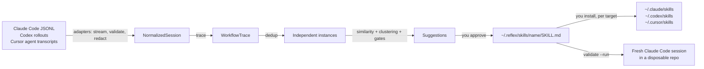

# Architecture

Reflex is a local CLI. It reads coding-agent history you point it at, and writes only inside its
own folder until you explicitly install a skill.

## Packages

| Package | Responsibility |
| --- | --- |
| `@reflex/core` | Session model (`NormalizedSession`, `SessionEvent`, `WorkflowTrace`), adapter interface, hashing, debug counters |
| `@reflex/safety` | Redaction, leak detection, path containment, slug validation, no-follow/exclusive file writes |
| `@reflex/adapters` | Claude Code, Codex and Cursor parsers: detection, permission prompt, bounded discovery, streaming parse |
| `@reflex/analysis` | Command classification, traces, de-duplication, similarity, clustering, consensus steps, suggestions |
| `@reflex/storage` | SQLite (`node:sqlite`) store in `REFLEX_HOME` (default `~/.reflex`) |
| `@reflex/skills` | SKILL.md generation, validation, diffs, install planning, fresh-task sandbox |
| `@reflex/test-fixtures` | Synthetic transcripts in the real on-disk layouts, for tests only (not bundled) |
| `apps/cli` | Commands and prompts (`commander`, `@clack/prompts`), bundled into one file with tsup |

Internal packages export TypeScript source; only the CLI is built.

## Adapters

Each adapter implements `detect` (location and file count, no reads), `requestPermission`,
`discover` (fixed depth, no symlinks, mtime window) and `parse` (stream line by line, Zod-validate,
skip bad lines, cap line size and events per session).

- Claude Code: `~/.claude/projects/<encoded-cwd>/<session>.jsonl`. `user`/`assistant` records with
  string or block content (`text`, `tool_use`, `tool_result`). Sidechain, meta, harness-injected and
  duplicate-uuid records are dropped.
- Codex: `$CODEX_HOME/sessions/YYYY/MM/DD/rollout-*.jsonl`. `{timestamp, type, payload}` lines:
  `session_meta`, `response_item` (messages, `shell`/`exec_command` calls, `local_shell_call`,
  `apply_patch`, outputs with exit codes), `event_msg`. The parser follows the Codex protocol types;
  it has been tested on fixtures, not on real rollouts (no Codex history on the development machine).
- Cursor: `~/.cursor/projects/<encoded-workspace>/agent-transcripts/<id>/<id>.jsonl`. `{role, message:
  {content: [text | tool_use]}}` lines plus `turn_ended` markers. The developer's request is the
  `<user_query>` block; session time comes from Cursor's `<timestamp>` tag. Tools map onto the same
  events (`Shell`, `Read`/`ReadFile`, `StrReplace`, `Write`, `ApplyPatch`, `Grep`/`rg`/`Glob`).
  Subagent transcripts and background-task notifications are skipped. The workspace path is decoded
  by checking which folders exist (metadata only). Cursor records no tool results, so its sessions
  never count as "recovered from a failure". Tested on fixtures and parsed cleanly on real history.

All text is truncated and redacted inside the adapter, before anything else sees it.

Token usage, where recorded, is attached to the session as `{input, output, cacheRead, cacheWrite}`:

- Claude Code: `message.usage` on assistant records, counted once per `message.id` (Claude Code
  repeats the same usage on every content-block record of one API message). Sidechain records are
  skipped, so subagent tokens are not included.
- Codex: the last cumulative `event_msg` `token_count.info.total_token_usage`. `input_tokens`
  includes `cached_input_tokens`, so the cached part is moved into `cacheRead`. Like the rest of the
  Codex parser, this follows the protocol types and is tested on fixtures only.
- Cursor: no usage in its transcripts.

## From sessions to suggestions

1. **Trace.** Each session becomes an ordered list of action categories (`inspect-ci`,
   `install-dependencies`, `modify-dependencies`, `run-tests`, `inspect-diff`, …), normalized
   commands (`gh run view <n> --log-failed`), file categories, outcome signals (failure then
   recovery, verification after the change) and intent terms from the user's requests.
2. **De-duplicate.** Byte-identical copies (same fingerprint), resumed sessions (≥ 80% event overlap)
   and quick retries (same repo within 4 hours, similar intent and actions) count once.
3. **Similarity.** Weighted: intent 0.40, action sequence 0.30, commands and tools 0.15, file
   categories 0.10, repository 0.05. Intent blends TF-IDF with a small concept lexicon so
   "GitHub Actions is red" and "CI is failing" match. Action similarity mixes exact sequence
   (LCS, Jaccard) with coarse classes (inspect, change, verify).
4. **Cluster.** Average-linkage agglomerative clustering, threshold 0.45.
5. **Gates.** A cluster becomes a suggestion only with ≥ 3 independent sessions, intent cohesion
   ≥ 0.2, action cohesion ≥ 0.5, and a non-generic trace (≥ 3 distinct actions). Read-and-answer
   sessions and generic "read, edit, test" behavior do not pass.
6. **Consensus.** Steps seen in at least half the sessions, ordered by pairwise precedence (A before B
   if most sessions containing both did A first). Different kinds of patch collapse into one
   "patch the root cause" step with the observed variants. Example commands must recur in two
   sessions and pass a safety filter.
7. **Rank.** Confidence is a heuristic over cohesion, instance count, repository spread, step
   consensus and verification rate. It is shown as a ranking signal, not a probability.

A small family catalog (`fix-ci`, `review-pr`, `debug-dependency`, …) names clusters. It never
creates or admits one.

## Cost and impact

Each suggestion carries a cost: run count, runs with token data, median whole-session tokens, summed
token mix and median tool calls. Runs that already loaded a skill with the suggestion's name are
excluded. `approve` stores this as the skill's baseline, and a later approval keeps the first one.
A trace records skill use from Claude Code's `Skill` tool call (plugin prefixes like `x:name` match),
from file reads, and from shell commands that mention `skills/<name>/SKILL.md`. Reflex's own copies
in `~/.reflex/skills` are excluded. `reflex impact` de-duplicates the current traces, takes the runs
that used the skill, and reports the relative change of each median only when both sides have at
least 3 runs.

## Skills

`approve` writes `~/.reflex/skills/<name>/SKILL.md`: frontmatter (`name`, `description`,
provenance metadata with short session references), when to use, numbered consensus steps,
completion criteria and notes. No transcript excerpts. The file is redacted again, checked for
leaks and kept at 150 lines or fewer.

`install` copies it into `~/.claude/skills/<name>/`, `~/.codex/skills/<name>/` or `~/.cursor/skills/<name>/` only after a
per-target confirmation, never overwriting. `validate --run` creates a fresh git repository with a
bug none of the historical sessions saw, installs the skill project-locally, and runs a
non-persistent Claude Code session with restricted tools to show the skill being invoked and the
tests passing.

## Storage

`~/.reflex/reflex.db` (mode 0600, directory 0700): scans, redacted traces, suggestions and their
status, generated skills (with their cost baseline) and installations. `PRAGMA user_version` gates
schema changes; version 2 adds `skills.baseline_json` in place.

## Configuration

| Variable | Purpose |
| --- | --- |
| `REFLEX_HOME` | Reflex data folder (default `~/.reflex`) |
| `REFLEX_CLAUDE_DIR`, `REFLEX_CODEX_DIR`, `CODEX_HOME`, `REFLEX_CURSOR_DIR` | Transcript locations |
| `REFLEX_CLAUDE_SKILLS_DIR`, `REFLEX_CODEX_SKILLS_DIR`, `REFLEX_CURSOR_SKILLS_DIR` | Install targets |
| `REFLEX_DEBUG=1` | Local counters on stderr (counts only, never content) |
| `REFLEX_REDACT_USER` | Extra user name to redact |
