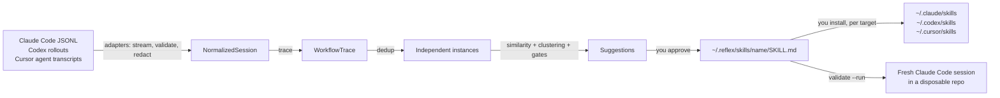

# Architecture

Reflex is a local CLI. It reads coding-agent history you point it at, and writes only inside its
own folder until you explicitly install a skill.

## Packages

| Package | Responsibility |
| --- | --- |
| `@reflex/core` | Session model (`NormalizedSession`, `SessionEvent`, `WorkflowTrace`), adapter interface, hashing, debug counters |
| `@reflex/safety` | Redaction, leak detection, path containment, slug validation, no-follow/exclusive file writes |
| `@reflex/adapters` | Claude Code, Codex and Cursor parsers: detection, permission prompt, bounded discovery, streaming parse |
| `@reflex/analysis` | Command classification, traces, de-duplication, similarity, clustering, consensus steps, suggestions |
| `@reflex/storage` | SQLite (`node:sqlite`) store in `REFLEX_HOME` (default `~/.reflex`) |
| `@reflex/embeddings` | Optional sentence embeddings: pinned model download and verification, WordPiece tokenizer, onnxruntime-web (WebAssembly) inference |
| `@reflex/skills` | SKILL.md generation, validation, diffs, install planning, fresh-task sandbox |
| `@reflex/test-fixtures` | Synthetic transcripts in the real on-disk layouts, for tests only (not bundled) |
| `@reflex/tui` | Full-screen terminal UI: the `TuiData` contract, layout ported from the design prototype, terminal I/O, and the live data source over the store |
| `apps/cli` | Commands and prompts (`commander`, `@clack/prompts`), bundled with tsup; the build copies the onnxruntime-web WebAssembly runtime (14 MB) next to the bundle |

Internal packages export TypeScript source; only the CLI is built.

## Adapters

Each adapter implements `detect` (location and file count, no reads), `requestPermission`,
`discover` (fixed depth, no symlinks, mtime window) and `parse` (stream line by line, Zod-validate,
skip bad lines, cap line size and events per session).

- Claude Code: `~/.claude/projects/<encoded-cwd>/<session>.jsonl`. `user`/`assistant` records with
  string or block content (`text`, `tool_use`, `tool_result`). Sidechain, meta, harness-injected and
  duplicate-uuid records are dropped.
- Codex: `$CODEX_HOME/sessions/YYYY/MM/DD/rollout-*.jsonl`. `{timestamp, type, payload}` lines:
  `session_meta`, `response_item` (messages, `shell`/`exec_command` calls, `local_shell_call`,
  `apply_patch`, outputs with exit codes), `event_msg`. The parser follows the Codex protocol types;
  it has been tested on fixtures, not on real rollouts (no Codex history on the development machine).
- Cursor: `~/.cursor/projects/<encoded-workspace>/agent-transcripts/<id>/<id>.jsonl`. `{role, message:
  {content: [text | tool_use]}}` lines plus `turn_ended` markers. The developer's request is the
  `<user_query>` block; session time comes from Cursor's `<timestamp>` tag. Tools map onto the same
  events (`Shell`, `Read`/`ReadFile`, `StrReplace`, `Write`, `ApplyPatch`, `Grep`/`rg`/`Glob`).
  Subagent transcripts and background-task notifications are skipped. The workspace path is decoded
  by checking which folders exist (metadata only). Cursor records no tool results, so its sessions
  never count as "recovered from a failure". Tested on fixtures and parsed cleanly on real history.

All text is truncated and redacted inside the adapter, before anything else sees it.

Token usage, where recorded, is attached to the session as `{input, output, cacheRead, cacheWrite}`:

- Claude Code: `message.usage` on assistant records, counted once per `message.id` (Claude Code
  repeats the same usage on every content-block record of one API message). Sidechain records are
  skipped, so subagent tokens are not included.
- Codex: the last cumulative `event_msg` `token_count.info.total_token_usage`. `input_tokens`
  includes `cached_input_tokens`, so the cached part is moved into `cacheRead`. Like the rest of the
  Codex parser, this follows the protocol types and is tested on fixtures only.
- Cursor: no usage in its transcripts.

## From sessions to suggestions

1. **Trace.** Each session becomes an ordered list of action categories (`inspect-ci`,
   `install-dependencies`, `modify-dependencies`, `run-tests`, `inspect-diff`, …), normalized
   commands (`gh run view <n> --log-failed`), file categories, outcome signals (failure then
   recovery, verification after the change) and intent terms from the user's requests.
2. **De-duplicate.** Byte-identical copies (same fingerprint), resumed sessions (≥ 80% event overlap)
   and quick retries (same repo within 4 hours, similar intent and actions) count once.
3. **Similarity.** Weighted: intent 0.40, action sequence 0.30, commands and tools 0.15, file
   categories 0.10, repository 0.05. Intent blends TF-IDF over stemmed terms (plus a bonus for
   shared word pairs) with a small concept lexicon so "GitHub Actions is red" and "CI is failing"
   match. With the optional model, each session's context document (redacted first request plus
   file kinds; actions are left out because they have their own weight) is embedded, and intent is
   the larger of the lexical score and the rescaled embedding cosine (`(cos - 0.2) / 0.8`).
   Meaning can connect requests that share no words but never lowers a lexical match. On the
   fixtures this raises same-vs-different pair separation (AUC) from 0.84 to 0.92. Action similarity mixes exact sequence
   (LCS, Jaccard) with coarse classes (inspect, change, verify).
4. **Cluster.** Average-linkage agglomerative clustering, threshold 0.45.
5. **Gates.** A cluster becomes a suggestion only with ≥ 3 independent sessions, intent cohesion
   ≥ 0.2, action cohesion ≥ 0.5, and a non-generic trace (≥ 3 distinct actions). Read-and-answer
   sessions and generic "read, edit, test" behavior do not pass.
6. **Consensus.** Steps seen in at least half the sessions, ordered by pairwise precedence (A before B
   if most sessions containing both did A first). Different kinds of patch collapse into one
   "patch the root cause" step with the observed variants. Example commands must recur in two
   sessions and pass a safety filter.
7. **Rank.** Confidence is a heuristic over cohesion, instance count, repository spread, step
   consensus and verification rate. It is shown as a ranking signal, not a probability.

8. **Constraints.** Follow-up requests (not the first) are split into clauses. A clause counts as a
   correction only if it opens with "don't / do not / never / stop / avoid / no need to" (avoid),
   or with "always / make sure / prefer", "X instead of Y", "X instead" or follows a bare "no"
   (prefer). A prefer clause must also open with a verb from a short allowlist (`use`, `run`, `keep`,
   `pin`, …). The trace keeps at most 8 plain words without filler, and at most 8 corrections per
   session. A clause with any non-word token (shell syntax, flags, URLs, paths, hosts, IP addresses,
   redaction markers) is dropped. Within a cluster, two corrections with the same polarity from
   different sessions match at stemmed-word Jaccard ≥ 0.5; the words after "not" only match each
   other, so "pnpm not npm" never matches "npm not pnpm". Each matching pair yields a rule made of
   the words both used, and its session count is the number of sessions that produced that same
   rule. Rules must be at most 80 characters and pass a steering-word filter (prompts, secrets,
   permissions, confirmation); prefer rules must also pass the command safety filter. At most 5 per
   skill.

A small family catalog (`fix-ci`, `review-pr`, `debug-dependency`, …) names clusters. It never
creates or admits one.

## Cost and impact

Each suggestion carries a cost: run count, runs with token data, median whole-session tokens, summed
token mix and median tool calls. Runs that already loaded a skill with the suggestion's name are
excluded. `approve` stores this as the skill's baseline, and a later approval keeps the first one.
A trace records skill use from Claude Code's `Skill` tool call (plugin prefixes like `x:name` match),
from file reads, and from shell commands that mention `skills/<name>/SKILL.md`. Reflex's own copies
in `~/.reflex/skills` are excluded. `reflex impact` de-duplicates the current traces, takes the runs
that used the skill, and reports the relative change of each median only when both sides have at
least 3 runs.

## Skills

`approve` writes `~/.reflex/skills/<name>/SKILL.md`: frontmatter (`name`, `description`,
provenance metadata with short session references), when to use, numbered consensus steps,
completion criteria and notes. No transcript excerpts. The file is redacted again, checked for
leaks and kept at 150 lines or fewer.

`install` copies it into `~/.claude/skills/<name>/`, `~/.codex/skills/<name>/` or `~/.cursor/skills/<name>/` only after a
per-target confirmation, never overwriting. In `reflex tui`, `space` on a pending suggestion runs the
same approval (`approveSuggestion` in `@reflex/skills`, shared with `approve`, except that the TUI
never replaces a Reflex copy you edited) and installs into every detected target. `space` on an
installed skill calls `uninstall`, which deletes a copy only if it is still byte for byte what
Reflex wrote, then drops its installation record. `validate --run` creates a fresh git repository with a
bug none of the historical sessions saw, installs the skill project-locally, and runs a
non-persistent Claude Code session with restricted tools to show the skill being invoked and the
tests passing.

## Terminal UI

`reflex tui` runs `@reflex/tui` on a live data source. The views never read the store: they draw
one plain value, `TuiData` (`packages/tui/src/model.ts`), and act through a `DataSource`
(`load`, `toggleItem`, `setAutopilot`, `rescan`, `resume`; `packages/tui/src/types.ts`). Optional
fields are measurements Reflex may not have; a view draws `not measured yet` for a missing block
and `—` for a missing value, and never invents a number.

The live source (`packages/tui/src/live/`) opens the store, builds `TuiData` and closes it again on
every load (at start, after a rescan and after each toggle).

| Field | Live value |
| --- | --- |
| `scannedAt`, `sessions` | Local time and session count of the latest scan |
| `reads`, `activeDirs`, `dataDir` | History folders the latest scan read, detected install folders, `REFLEX_HOME` |
| `tools` | Sessions per source in the latest scan |
| `window`, `days`, `yesterday` | Token sums from the stored traces' `usage`, per local day of the scan window; yesterday only when the scan covers all of it |
| `skills` | Generated skills and pending suggestions; `new` = pending, `retired` = the latest scan no longer found it, `on` = an installation record whose file is still there |
| `attention` | New suggestions to review, retired skills still installed |
| `workflows` | Pending and approved suggestions with their evidence; `on` = the skill generated from it is installed. No `runAs`: a workflow installs as its skill |
| `search` | Each stored trace's excerpt (turn 1) and display steps (turns 2..), keyed by the first 8 characters of the native session id |
| `money`, `limits`, `plansFile`, `topPrompts`, `topSessions`, `router` | Not recorded, so absent |

Sessions found twice (the same session id in two places) count once in token sums. Cursor records
no tokens, so a day or window with only Cursor sessions has no token value. More in
[tui.md](tui.md).

## Storage

`~/.reflex/reflex.db` (mode 0600, directory 0700): scans, redacted traces, suggestions and their
status, generated skills (with their cost baseline) and installations. `PRAGMA user_version` gates
schema changes; version 2 adds `skills.baseline_json` in place; version 3 adds `embeddings`
(vectors keyed by a hash of model id and context document, pruned to the latest scan).

The optional model lives in `~/.reflex/models/all-minilm-l6-v2-q8/` (23 MB, int8 ONNX). It is read
only after its SHA-256 matches the pinned value, and is embedded one text at a time: the int8
model quantizes per batch, so batching would make a session's vector depend on its neighbors.

## Configuration

| Variable | Purpose |
| --- | --- |
| `REFLEX_HOME` | Reflex data folder (default `~/.reflex`) |
| `REFLEX_CLAUDE_DIR`, `REFLEX_CODEX_DIR`, `CODEX_HOME`, `REFLEX_CURSOR_DIR` | Transcript locations |
| `REFLEX_CLAUDE_SKILLS_DIR`, `REFLEX_CODEX_SKILLS_DIR`, `REFLEX_CURSOR_SKILLS_DIR` | Install targets |
| `REFLEX_DEBUG=1` | Local counters on stderr (counts only, never content) |
| `REFLEX_REDACT_USER` | Extra user name to redact |
